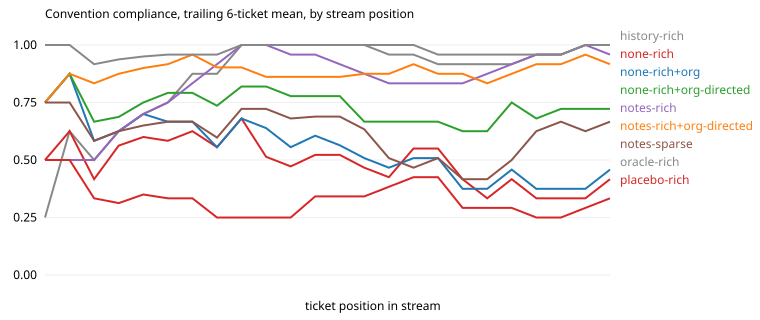

# continual-learning-bench

A prototype benchmark that asks one question: when a coding agent works inside one company's codebase, how much does it improve from the feedback that company already produces?

The agent works through a stream of 24 tickets in a small private codebase. After each ticket it gets what a new hire gets: a CI result and code review comments. The team has rules that nobody wrote down. The benchmark scores how fast the agent stops breaking them.

Status: prototype. One model, two runs per arm. Read the numbers as a demonstration that the benchmark separates learners, not as a ranking.

## Why this benchmark

Published continual-learning benchmarks for coding agents replay public GitHub issues and score them with gold tests. `reports/` has the survey. Three things are missing from them:

- The learning signal is never deployment feedback. No benchmark we found gives the agent CI output and review comments and holds the gold tests back for scoring.
- None test rules that exist only inside one organization. Public repos are in the training data, so a public-repo benchmark cannot tell "learned on the job" from "already knew".
- None compare how much an agent learns as the feedback gets worse. A real organization mostly produces "merged" or "not merged", not a reviewer who explains the rule.

This prototype covers those three gaps at small scale. It also gives the agent the other places a company keeps its knowledge (Slack, Notion, old pull request threads), and measures whether the agent finds a rule there before it breaks the rule.

## How it works

### The organization

`org/seed/` is `parcelo`, a small shipping service written for this benchmark, so no model has seen it. It is written in two styles on purpose. Older modules use floats for money, `datetime.now()`, `uuid`, `ValueError`, and `print`. One newer module follows the rules the team now enforces. An agent that copies the code around it gets the rules wrong about as often as right.

`org/conventions.json` holds the nine team rules. Each rule has the handbook sentence that the oracle arm sees and the review comment that a reviewer writes when the rule is broken.

| id | rule |
|---|---|
| `money` | currency is `Money`, never a float |
| `clock` | read time through `clock.now()` |
| `errors` | raise `DomainError` with a registered code |
| `audit` | every state change calls `audit.record` (tickets 1 to 14) |
| `events` | every state change calls `events.emit`, and `audit.record` is banned (tickets 15 to 24) |
| `ids` | ids come from `ids.new_id(prefix)` |
| `changelog` | one bullet under `## Unreleased` ending with the ticket id |
| `tests` | new tests go in a new file under `tests/unit/` |
| `no_legacy` | never import `parcelo.legacy` |

After ticket 14 the team migrates from the audit log to an events outbox (`org/migration/`). The rule the agent learned in the first half is now wrong. The benchmark uses that change to measure how fast a learner drops a stale rule.

### The company's written knowledge

`org/knowledge/` is a simulated history of the team: 248 Slack messages in six channels, 8 Notion pages, and 6 old pull request threads. About 4% of the Slack messages bear on a rule. The rest is deploys, on-call, customer problems, and lunch.

Each rule is planted in a different way, so the benchmark can tell apart the ways written knowledge fails:

| rule | what the written record says |
|---|---|
| `money` | stated in a Slack incident thread and one PR review |
| `clock` | stated as an action item in a Notion postmortem |
| `errors` | explained by a reviewer in a PR thread |
| `audit` | stated on a Notion guidelines page from 2025 that nobody updates |
| `events` | announced in Slack the evening before the migration. The guidelines page still says `audit.record`. |
| `ids` | only implied, in a support thread about tooling that broke on an odd id |
| `changelog` | a Notion page describes the old format. A newer Slack message from the release manager gives the current one. |
| `no_legacy` | a junior engineer says importing it is fine. A senior engineer says the opposite a month later. |
| `tests` | nothing is written anywhere. Only a reviewer can teach this rule. |

One ticket happens per day, starting 2026-03-02. At each ticket the agent gets a `../company/` folder that holds only what was dated before that day, so the migration announcement does not exist until ticket 15. `python -m clbench.knowledge` checks the planted evidence against `org/knowledge/evidence.json`: every needle is present, the right evidence is visible at each rule's first ticket, nothing announces the migration early, and no document names a ticket or says where tests go.

`--knowledge available` tells the agent the folder exists. `--knowledge directed` also tells the agent to search the folder before it writes code. Arms that use the folder carry `+org` or `+org-directed` in their name.

### A ticket

Each directory in `org/tickets/` holds:

- `ticket.json`: the text the agent sees, and the list of rules the ticket exercises. The text never mentions a rule.
- `hidden/test_ci.py`: functional tests. They accept both the old style and the new style.
- `hidden/test_conv.py`: one test per rule.
- `gold/`: a solution that follows every rule.
- `naive/`: a solution in the old style. It passes CI and breaks every listed rule.

`python -m clbench.validate` checks all 24 tickets: the gold solution must merge, and the naive solution must pass CI and fail every listed rule. A rule check that the naive solution cannot fail is a bug in the benchmark, and the validator reports it.

### One step of the stream

1. The harness copies the codebase to a fresh temporary directory.
2. The learner supplies context. The context goes into the prompt above the ticket.
3. A headless coding agent edits the code. It gets one attempt.
4. The grader runs the hidden tests and the rule checks.
5. The feedback mode turns the grade into text, and the learner updates its state from that text.

The agent never sees the hidden tests, the rule list, or the gold solution.

### Learners

`clbench/learners.py` defines a learner as a state dict and two functions, `context` and `observe`.

| arm | what the agent knows at ticket N |
|---|---|
| `none` | nothing. This arm is the stateless baseline. |
| `placebo` | a fixed block of true facts about the repo that contains no rule. It controls for "any extra context helps". |
| `history` | the raw feedback text from tickets 1 to N-1, appended. |
| `notes` | notes the agent rewrites after every ticket from its diff and the feedback. Capped at 3000 characters. |
| `oracle` | the team handbook. This arm is the ceiling. |

All of these learners change context, not weights. A weight-update learner fits the same two functions, but this prototype has no weight access.

### Feedback modes

`clbench/feedback.py` controls what the learner sees.

- `rich`: CI status, failing test names, and the reviewer's comment for each broken rule.
- `sparse`: `CI: passed`, `Code review: changes requested`, `Outcome: not merged`. No explanation.

The gap between `notes-rich` and `notes-sparse` is the value of the explanation.

### Metrics

`python -m clbench.report <run>` writes `results/<run>/results.md` and a learning curve.

- **Compliance**: share of the ticket's listed rules that the change follows.
- **First-try merge**: CI passed and no rule broken.
- **Gain vs stateless**: mean per-ticket compliance minus the `none` arm on the same ticket, with a paired bootstrap 95% interval over tickets.
- **Oracle gap closed**: that gain divided by the oracle's gain.
- **Repeat-violation rate**: after a reviewer has explained a rule once, how often the agent breaks it again. This is the number a team lead feels.
- **Compliance by exposure**: first time the agent meets a rule, second and third, fourth and later.
- **Migration row**: the `events` outcomes in order after the rule change.
- **Cost per ticket**: solve cost plus learning cost, as reported by the CLI.

## Run it

```
uv venv .venv && uv pip install --python .venv/bin/python pytest
.venv/bin/python -m clbench.validate
./run_all.sh my-run claude:haiku
./run_org.sh my-run claude:haiku
.venv/bin/python -m clbench.report my-run
```

`run_all.sh` needs the `claude` CLI on your path and logged in. Each arm appends to `runs/<run>/<arm>/attempts.jsonl` and resumes from there if you rerun it. `--agent gold` and `--agent noop` run without a model.

## Results

Agent: Claude Haiku through the headless `claude` CLI. Two independent runs of the full 24-ticket stream per arm, 432 agent attempts in total across nine arms. Each cell is the mean of the two runs, with the lower and higher run in brackets. `results/combined.md` has this table, and `results/haiku-s1/` and `results/haiku-s2/` have the per-run tables and curves. Regenerate them with `python -m clbench.report haiku-s1 haiku-s2`.

| arm | compliance | first-try merge | gain vs stateless | repeat-violation rate |
|---|---|---|---|---|
| `none` (stateless) | 0.47 [0.46, 0.48] | 0.04 [0.04, 0.04] | 0 | 0.57 [0.53, 0.61] |
| `placebo` | 0.33 [0.33, 0.34] | 0.02 [0.00, 0.04] | -0.14 [-0.16, -0.12] | 0.69 [0.66, 0.71] |
| `notes`, sparse feedback | 0.50 [0.38, 0.61] | 0.04 [0.00, 0.08] | +0.02 [-0.08, +0.12] | 0.63 [0.61, 0.64] |
| `notes`, rich feedback | 0.89 [0.88, 0.90] | 0.67 [0.62, 0.71] | +0.41 [+0.39, +0.44] | 0.06 [0.04, 0.08] |
| `history`, rich feedback | 0.92 [0.92, 0.92] | 0.79 [0.75, 0.83] | +0.45 [+0.43, +0.46] | 0.00 [0.00, 0.00] |
| `oracle` (handbook) | 0.99 [0.98, 1.00] | 0.94 [0.88, 1.00] | +0.52 [+0.49, +0.54] | 0.00 [0.00, 0.00] |



What the two runs show:

- **The benchmark separates learners.** The stateless agent follows 47% of the rules and merges 4% of tickets on the first try. The handbook takes the same agent to 99% and 94%. That 52-point gap is the room a learner has.
- **With review comments, the agent learns most of the handbook on its own.** Self-written notes close about 80% of the gap to the oracle, and raw feedback history about 86%. The first time the agent meets a rule it follows it 33% to 44% of the time. From the second meeting on it follows it 89% of the time or more.
- **Without the explanation, the agent learns nothing measurable.** With only "merged" or "not merged", the notes arm lands at +0.02 over stateless, and the two runs disagree on the sign (-0.08 and +0.12). The agent fills its notes with guesses about why it was rejected.
- **The rule change shows the same split.** After the migration, both rich-feedback arms break the new `events` rule once, get one review comment, and then follow it (7 of 7 for `history` in both runs, 7 of 7 and 5 of 7 for `notes`). The sparse arm follows it 0 times in 16 tries.
- **Plain history beats curated notes at this length.** At 24 tickets the full feedback log is about 3,700 characters, so nothing forces compression yet. A longer stream is needed to see where the log stops fitting.
- **The placebo arm scored below stateless in both runs** (-0.16 and -0.12). Extra context that carries no rules did not help. Why it hurt is not established. One guess is that the line "keep the change small" discourages changelog entries and new test files.

### With the company's Slack, Notion, and pull request history

| arm | compliance | first-try merge | followed on first exposure | agent turns per ticket |
|---|---|---|---|---|
| `none` (stateless, no folder) | 0.47 [0.46, 0.48] | 0.04 | 0.50 | 12.2 |
| `none` + folder available | 0.56 [0.53, 0.59] | 0.12 | 0.67 | 14.2 |
| `none` + told to search the folder | 0.74 [0.73, 0.75] | 0.25 | 0.72 | 19.6 |
| `notes`, rich feedback, no folder | 0.89 [0.88, 0.90] | 0.67 | 0.33 | 12.1 |
| `notes`, rich feedback + told to search | 0.90 [0.89, 0.92] | 0.58 | 0.78 | 18.7 |

"Followed on first exposure" pools both runs (18 first meetings per arm). `results/combined.md` has the per-rule table that the points below quote.

- **Access is not use.** With the folder only mentioned, compliance moved from 0.47 to 0.56. Told to search first, the same agent reached 0.74. The agent took 14 turns per ticket in the first case and 20 in the second, so the difference is whether it looked.
- **Written knowledge fixes the first mistake. Feedback fixes the rest.** Notes with review comments reach 0.89 overall but follow a rule only 33% of the time on first meeting, because the agent has to break a rule once to learn it. Adding search lifts first-meeting compliance to 78% and leaves the overall number where it was.
- **A rule nobody wrote down stays unlearned without a reviewer.** For `tests`, the stateless agent with search follows the rule 17% of the time. With review comments it reaches 83% to 92%.
- **The agent caught the migration from Slack.** After the rule change, the stateless agent with directed search followed `events` on 14 of 16 tries, against 1 of 16 with no folder. In both runs it followed the rule on the first ticket after the announcement, before any reviewer mentioned it.
- **Stale and conflicting sources cost accuracy.** With directed search, compliance is 1.00 on `audit` (one clear page) and 0.95 on `clock`, but 0.68 on `changelog` (old Notion page against a newer Slack message) and 0.67 on `no_legacy` (two people disagree).
- **Search plus notes did not raise first-try merges.** It scored 0.58 against 0.67 for notes alone. The ranges of the two runs nearly touch (0.54 to 0.62 against 0.62 to 0.71), so two runs do not settle whether that drop is real.

What limits these numbers: the run-to-run spread on compliance is 0.03 or less for every arm except sparse notes, where it is 0.23. Every attempt ran to completion with no CLI error, and CI pass rate is 0.92 or higher in every arm, so the gaps come from rule-following and not from failed runs. Two runs give a range, not a confidence interval.

## Limits

- **Two runs, 24 tickets, one model.** A whole stream is one sample, so there are two samples per arm. The brackets are a range, not a confidence interval.
- **The codebase does not grow.** Every ticket starts from the same snapshot (one of two). The agent's own earlier changes do not persist, so the benchmark does not measure error build-up.
- **The reviewer is a script.** It always catches a broken rule and always explains it well. Real reviewers miss things and most agent PRs get no comment. The `sparse` mode is the first step toward that.
- **The Slack and Notion history is generated.** A model wrote it to a design. It is messier than a handbook and cleaner than a real workspace, and 248 messages is small. A real export is thousands of times larger, so finding the right message is easier here than in a real company.
- **The rules are synthetic.** Nine clean rules are easier to learn than the taste of a real team.
- **The agent can read the repo it works in, and nothing else is sandboxed.** The hidden tests live outside the workspace, but a determined agent with shell access could look for them.
- **Ticket order is fixed.** `--order shuffled` exists and has not been run.
