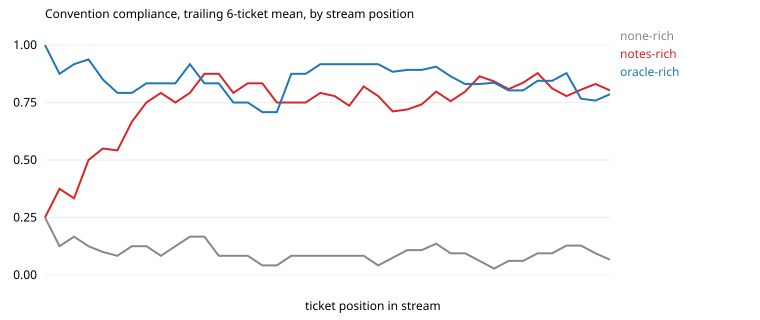

# Results: run `gemma-s1`

| arm | tickets | CI pass | compliance | hidden-rule compliance | first-try merge | early / mid / late compliance | gain vs stateless (95% CI) | oracle gap closed | repeat-violation rate | $ per ticket |
|---|---|---|---|---|---|---|---|---|---|---|
| none-rich | 24 | 0.83 | 0.09 | 0.07 | 0.00 | 0.12 / 0.06 / 0.09 | n/a | n/a | 0.92 (n=84) | 0.000 |
| notes-rich | 24 | 0.83 | 0.74 | 0.73 | 0.38 | 0.66 / 0.78 / 0.77 | +0.64 (+0.53, +0.75) | 84% | 0.19 (n=84) | 0.000 |
| oracle-rich | 24 | 0.83 | 0.85 | 0.83 | 0.62 | 0.84 / 0.78 / 0.94 | +0.76 (+0.66, +0.84) | 100% | 0.31 (n=32) | 0.000 |

Hidden rules are the ones the stateless arm follows less than half the time: `audit`, `changelog`, `clock`, `errors`, `events`, `ids`, `money`, `tests`.

## Compliance by how many times the agent has met the convention

| arm | 1st exposure | 2nd to 3rd | 4th and later |
|---|---|---|---|
| none-rich | 0.22 | 0.06 | 0.09 |
| notes-rich | 0.22 | 0.67 | 0.82 |
| oracle-rich | 0.89 | 0.72 | 0.87 |

## After the migration (`events` replaces `audit`)

| arm | `events` outcomes in order (1 = followed) |
|---|---|
| none-rich | 0 0 0 0 0 0 0 0 |
| notes-rich | 0 1 1 1 1 1 1 1 |
| oracle-rich | 1 1 1 1 1 1 1 1 |

