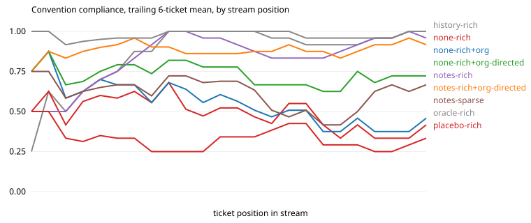

# Results: run `haiku-s1`

| arm | tickets | CI pass | compliance | first-try merge | early / mid / late compliance | gain vs stateless (95% CI) | oracle gap closed | repeat-violation rate | $ per ticket |
|---|---|---|---|---|---|---|---|---|---|
| history-rich | 24 | 0.96 | 0.92 | 0.83 | 0.81 / 0.97 / 0.97 | +0.43 (+0.30, +0.56) | 87% | 0.00 (n=71) | 0.006 |
| none-rich | 24 | 0.96 | 0.48 | 0.04 | 0.57 / 0.51 / 0.38 | n/a | n/a | 0.53 (n=73) | 0.006 |
| none-rich+org | 24 | 0.96 | 0.53 | 0.08 | 0.64 / 0.54 / 0.41 | +0.04 (-0.02, +0.10) | 8% | 0.57 (n=61) | 0.007 |
| none-rich+org-directed | 24 | 0.96 | 0.73 | 0.21 | 0.77 / 0.69 / 0.73 | +0.24 (+0.16, +0.33) | 49% | 0.28 (n=60) | 0.011 |
| notes-rich | 24 | 0.96 | 0.88 | 0.62 | 0.81 / 0.88 / 0.94 | +0.39 (+0.26, +0.52) | 79% | 0.04 (n=76) | 0.009 |
| notes-rich+org-directed | 24 | 0.92 | 0.89 | 0.54 | 0.90 / 0.88 / 0.91 | +0.41 (+0.30, +0.52) | 82% | 0.06 (n=48) | 0.014 |
| notes-sparse | 24 | 1.00 | 0.61 | 0.08 | 0.64 / 0.57 / 0.62 | +0.12 (+0.02, +0.25) | 25% | 0.61 (n=49) | 0.009 |
| oracle-rich | 24 | 0.92 | 0.98 | 0.88 | 0.97 / 1.00 / 0.97 | +0.49 (+0.38, +0.61) | 100% | 0.00 (n=12) | 0.006 |
| placebo-rich | 24 | 0.96 | 0.33 | 0.00 | 0.31 / 0.35 / 0.31 | -0.16 (-0.27, -0.06) | -32% | 0.71 (n=76) | 0.004 |

## Compliance by how many times the agent has met the convention

| arm | 1st exposure | 2nd to 3rd | 4th and later |
|---|---|---|---|
| history-rich | 0.33 | 0.94 | 0.99 |
| none-rich | 0.56 | 0.50 | 0.49 |
| none-rich+org | 0.67 | 0.61 | 0.50 |
| none-rich+org-directed | 0.67 | 0.83 | 0.72 |
| notes-rich | 0.33 | 0.94 | 0.93 |
| notes-rich+org-directed | 0.78 | 1.00 | 0.88 |
| notes-sparse | 0.56 | 0.61 | 0.62 |
| oracle-rich | 0.89 | 1.00 | 0.99 |
| placebo-rich | 0.44 | 0.22 | 0.35 |

## After the migration (`events` replaces `audit`)

| arm | `events` outcomes in order (1 = followed) |
|---|---|
| history-rich | 0 1 1 1 1 1 1 1 |
| none-rich | 1 0 0 0 0 0 0 0 |
| none-rich+org | 1 0 0 0 1 0 0 0 |
| none-rich+org-directed | 1 0 1 1 1 1 1 1 |
| notes-rich | 0 1 1 1 1 1 1 1 |
| notes-rich+org-directed | 1 1 1 0 1 1 1 1 |
| notes-sparse | 0 0 0 0 0 0 0 0 |
| oracle-rich | 1 1 1 1 1 1 1 1 |
| placebo-rich | 0 0 0 0 0 0 1 0 |

