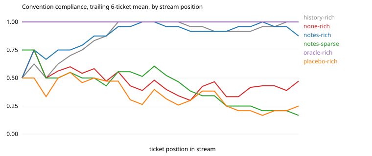

# Results: run `haiku-s2`

| arm | tickets | CI pass | compliance | hidden-rule compliance | first-try merge | early / mid / late compliance | gain vs stateless (95% CI) | oracle gap closed | repeat-violation rate | $ per ticket |
|---|---|---|---|---|---|---|---|---|---|---|
| history-rich | 24 | 0.92 | 0.92 | 0.89 | 0.75 | 0.81 / 0.97 / 0.97 | +0.46 (+0.33, +0.59) | 85% | 0.00 (n=70) | 0.006 |
| none-rich | 24 | 0.96 | 0.46 | 0.03 | 0.04 | 0.54 / 0.38 / 0.45 | n/a | n/a | 0.61 (n=71) | 0.005 |
| none-rich+org | 24 | 0.96 | 0.59 | 0.24 | 0.17 | 0.67 / 0.60 / 0.50 | +0.13 (+0.03, +0.24) | 24% | 0.44 (n=68) | 0.007 |
| none-rich+org-directed | 24 | 0.96 | 0.75 | 0.59 | 0.29 | 0.80 / 0.78 / 0.67 | +0.29 (+0.20, +0.39) | 54% | 0.30 (n=53) | 0.011 |
| notes-rich | 24 | 0.96 | 0.90 | 0.78 | 0.71 | 0.84 / 0.94 / 0.91 | +0.44 (+0.31, +0.57) | 81% | 0.08 (n=51) | 0.009 |
| notes-rich+org-directed | 24 | 0.88 | 0.92 | 0.84 | 0.62 | 0.91 / 0.94 / 0.91 | +0.46 (+0.34, +0.58) | 85% | 0.11 (n=36) | 0.014 |
| notes-sparse | 24 | 0.96 | 0.38 | 0.08 | 0.00 | 0.51 / 0.41 / 0.22 | -0.08 (-0.18, +0.03) | -14% | 0.64 (n=76) | 0.009 |
| oracle-rich | 24 | 1.00 | 1.00 | 1.00 | 1.00 | 1.00 / 1.00 / 1.00 | +0.54 (+0.43, +0.66) | 100% | nan (n=0) | 0.006 |
| placebo-rich | 24 | 0.96 | 0.34 | 0.03 | 0.04 | 0.48 / 0.29 / 0.25 | -0.12 (-0.20, -0.05) | -22% | 0.66 (n=80) | 0.004 |

Hidden rules are the ones the stateless arm follows less than half the time: `events`, `money`, `no_legacy`, `tests`.

## Compliance by how many times the agent has met the convention

| arm | 1st exposure | 2nd to 3rd | 4th and later |
|---|---|---|---|
| history-rich | 0.44 | 0.89 | 0.99 |
| none-rich | 0.44 | 0.50 | 0.46 |
| none-rich+org | 0.67 | 0.72 | 0.56 |
| none-rich+org-directed | 0.78 | 0.83 | 0.74 |
| notes-rich | 0.33 | 1.00 | 0.94 |
| notes-rich+org-directed | 0.78 | 0.94 | 0.93 |
| notes-sparse | 0.56 | 0.39 | 0.37 |
| oracle-rich | 1.00 | 1.00 | 1.00 |
| placebo-rich | 0.44 | 0.33 | 0.34 |

## After the migration (`events` replaces `audit`)

| arm | `events` outcomes in order (1 = followed) |
|---|---|
| history-rich | 0 1 1 1 1 1 1 1 |
| none-rich | 0 0 0 0 0 0 0 0 |
| none-rich+org | 1 0 1 1 0 0 0 0 |
| none-rich+org-directed | 1 0 1 1 1 1 1 1 |
| notes-rich | 0 1 1 1 1 0 1 0 |
| notes-rich+org-directed | 1 1 1 0 1 0 1 1 |
| notes-sparse | 0 0 0 0 0 0 0 0 |
| oracle-rich | 1 1 1 1 1 1 1 1 |
| placebo-rich | 0 0 0 0 0 0 0 0 |

