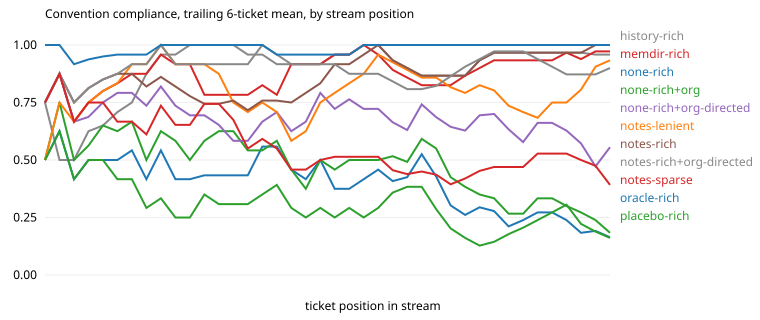

# Results: run `haiku-v2-s1`

| arm | tickets | CI pass | compliance | hidden-rule compliance | first-try merge | early / mid / late compliance | gain vs stateless (95% CI) | oracle gap closed | repeat-violation rate | $ per ticket |
|---|---|---|---|---|---|---|---|---|---|---|
| history-rich | 40 | 0.97 | 0.91 | 0.90 | 0.72 | 0.87 / 0.91 / 0.97 | +0.54 (+0.43, +0.64) | 88% | 0.01 (n=148) | 0.005 |
| memdir-rich | 40 | 0.95 | 0.89 | 0.83 | 0.65 | 0.82 / 0.89 / 0.96 | +0.51 (+0.41, +0.62) | 84% | 0.05 (n=129) | 0.018 |
| none-rich | 40 | 0.97 | 0.38 | 0.10 | 0.00 | 0.49 / 0.44 / 0.20 | n/a | n/a | 0.66 (n=149) | 0.004 |
| none-rich+org | 40 | 0.97 | 0.45 | 0.21 | 0.10 | 0.63 / 0.47 / 0.25 | +0.07 (+0.01, +0.13) | 12% | 0.59 (n=143) | 0.006 |
| none-rich+org-directed | 40 | 0.97 | 0.67 | 0.38 | 0.23 | 0.72 / 0.70 / 0.57 | +0.29 (+0.22, +0.36) | 47% | 0.37 (n=125) | 0.009 |
| notes-lenient | 40 | 0.97 | 0.82 | 0.62 | 0.53 | 0.87 / 0.78 / 0.83 | +0.45 (+0.36, +0.54) | 73% | 0.15 (n=130) | 0.009 |
| notes-rich | 40 | 0.97 | 0.88 | 0.83 | 0.57 | 0.81 / 0.85 / 0.98 | +0.50 (+0.41, +0.60) | 82% | 0.06 (n=124) | 0.008 |
| notes-rich+org-directed | 40 | 0.97 | 0.90 | 0.81 | 0.62 | 0.90 / 0.88 / 0.93 | +0.53 (+0.44, +0.61) | 86% | 0.08 (n=90) | 0.014 |
| notes-sparse | 40 | 0.95 | 0.53 | 0.22 | 0.07 | 0.71 / 0.45 / 0.45 | +0.16 (+0.08, +0.23) | 26% | 0.54 (n=132) | 0.010 |
| oracle-rich | 40 | 0.95 | 0.99 | 0.98 | 0.93 | 0.98 / 0.98 / 1.00 | +0.61 (+0.53, +0.70) | 100% | 0.00 (n=17) | 0.006 |
| placebo-rich | 40 | 0.97 | 0.28 | 0.07 | 0.00 | 0.37 / 0.29 / 0.18 | -0.10 (-0.16, -0.03) | -16% | 0.74 (n=155) | 0.004 |

Hidden rules, which a stateless frontier model follows less than half the time: `idempotent`, `money`, `no_legacy`, `settings`, `sorted`, `tests`.

## Compliance by how many times the agent has met the convention

| arm | 1st exposure | 2nd to 3rd | 4th and later |
|---|---|---|---|
| history-rich | 0.29 | 0.89 | 0.99 |
| memdir-rich | 0.36 | 0.86 | 0.95 |
| none-rich | 0.43 | 0.36 | 0.37 |
| none-rich+org | 0.43 | 0.57 | 0.43 |
| none-rich+org-directed | 0.64 | 0.68 | 0.67 |
| notes-lenient | 0.36 | 0.82 | 0.88 |
| notes-rich | 0.36 | 1.00 | 0.92 |
| notes-rich+org-directed | 0.64 | 1.00 | 0.91 |
| notes-sparse | 0.50 | 0.61 | 0.51 |
| oracle-rich | 0.93 | 1.00 | 0.99 |
| placebo-rich | 0.43 | 0.25 | 0.27 |

## Rules introduced by a mid-stream change

| arm | `events` in order (1 = followed) | `changelog2` in order (1 = followed) | `sorted` in order (1 = followed) | `idempotent` in order (1 = followed) | `settings` in order (1 = followed) | `docs_api` in order (1 = followed) |
|---|---|---|---|---|---|---|
| history-rich | 0111111111111111 | 01111111 | 011111 | 011111 | 011111 | 011111111101 |
| memdir-rich | 0111111111111111 | 01111011 | 011111 | 010111 | 011111 | 011111111111 |
| none-rich | 1000001000000000 | 00000000 | 000000 | 110010 | 000000 | 001000000000 |
| none-rich+org | 0010101000000000 | 00000000 | 000000 | 110010 | 000000 | 111000010100 |
| none-rich+org-directed | 1011111111110001 | 10110101 | 000000 | 000010 | 101101 | 111111101001 |
| notes-lenient | 0111111111111111 | 00111111 | 000011 | 011111 | 000011 | 111111111111 |
| notes-rich | 0111111111111111 | 01111111 | 011111 | 011111 | 011111 | 011111111111 |
| notes-rich+org-directed | 1111110111110111 | 11111111 | 011101 | 011101 | 111011 | 111111111111 |
| notes-sparse | 0000000000000000 | 01100010 | 000000 | 110010 | 000000 | 111101111100 |
| oracle-rich | 1111111111111111 | 11111111 | 111111 | 111111 | 111111 | 111111111111 |
| placebo-rich | 0000000000000000 | 00000000 | 000000 | 110010 | 000000 | 100000000000 |

