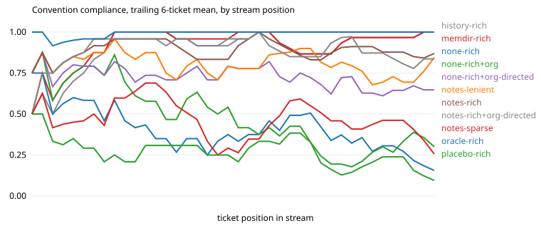

# Results: run `haiku-v2-s2`

| arm | tickets | CI pass | compliance | hidden-rule compliance | first-try merge | early / mid / late compliance | gain vs stateless (95% CI) | oracle gap closed | repeat-violation rate | $ per ticket |
|---|---|---|---|---|---|---|---|---|---|---|
| history-rich | 40 | 0.97 | 0.93 | 0.90 | 0.78 | 0.88 / 0.91 / 0.98 | +0.55 (+0.45, +0.66) | 89% | 0.00 (n=145) | 0.005 |
| memdir-rich | 40 | 0.97 | 0.94 | 0.90 | 0.82 | 0.90 / 0.92 / 0.98 | +0.56 (+0.46, +0.67) | 91% | 0.00 (n=134) | 0.025 |
| none-rich | 40 | 0.97 | 0.37 | 0.10 | 0.00 | 0.49 / 0.37 / 0.26 | n/a | n/a | 0.67 (n=144) | 0.004 |
| none-rich+org | 40 | 0.97 | 0.46 | 0.22 | 0.10 | 0.69 / 0.41 / 0.27 | +0.08 (+0.01, +0.17) | 14% | 0.63 (n=135) | 0.006 |
| none-rich+org-directed | 40 | 0.97 | 0.72 | 0.36 | 0.23 | 0.76 / 0.74 / 0.65 | +0.35 (+0.26, +0.43) | 56% | 0.32 (n=115) | 0.010 |
| notes-lenient | 40 | 0.97 | 0.81 | 0.64 | 0.45 | 0.87 / 0.79 / 0.78 | +0.44 (+0.36, +0.52) | 71% | 0.21 (n=108) | 0.010 |
| notes-rich | 40 | 0.95 | 0.89 | 0.81 | 0.57 | 0.92 / 0.87 / 0.89 | +0.52 (+0.42, +0.62) | 84% | 0.07 (n=102) | 0.009 |
| notes-rich+org-directed | 40 | 0.97 | 0.90 | 0.81 | 0.65 | 0.92 / 0.90 / 0.87 | +0.52 (+0.42, +0.62) | 84% | 0.08 (n=92) | 0.013 |
| notes-sparse | 40 | 1.00 | 0.45 | 0.14 | 0.03 | 0.59 / 0.40 / 0.36 | +0.07 (+0.01, +0.14) | 12% | 0.57 (n=148) | 0.010 |
| oracle-rich | 40 | 0.97 | 0.99 | 0.98 | 0.97 | 0.98 / 1.00 / 1.00 | +0.62 (+0.53, +0.71) | 100% | 0.00 (n=13) | 0.006 |
| placebo-rich | 40 | 0.97 | 0.25 | 0.07 | 0.00 | 0.32 / 0.27 / 0.15 | -0.13 (-0.19, -0.06) | -20% | 0.76 (n=157) | 0.004 |

Hidden rules, which a stateless frontier model follows less than half the time: `idempotent`, `money`, `no_legacy`, `settings`, `sorted`, `tests`.

## Compliance by how many times the agent has met the convention

| arm | 1st exposure | 2nd to 3rd | 4th and later |
|---|---|---|---|
| history-rich | 0.29 | 0.93 | 0.99 |
| memdir-rich | 0.29 | 0.96 | 1.00 |
| none-rich | 0.50 | 0.36 | 0.37 |
| none-rich+org | 0.50 | 0.54 | 0.43 |
| none-rich+org-directed | 0.50 | 0.71 | 0.75 |
| notes-lenient | 0.43 | 0.75 | 0.86 |
| notes-rich | 0.50 | 0.93 | 0.92 |
| notes-rich+org-directed | 0.57 | 0.96 | 0.91 |
| notes-sparse | 0.43 | 0.43 | 0.46 |
| oracle-rich | 0.93 | 1.00 | 1.00 |
| placebo-rich | 0.36 | 0.14 | 0.26 |

## Rules introduced by a mid-stream change

| arm | `events` in order (1 = followed) | `changelog2` in order (1 = followed) | `docs_api` in order (1 = followed) |
|---|---|---|---|
| history-rich | 0111111111111111 | 01111111 | 011111111111 |
| memdir-rich | 0111111111111111 | 01111111 | 011111111111 |
| none-rich | 0000000000000000 | 00000000 | 110100000000 |
| none-rich+org | 1000000000000010 | 00000100 | 010000010000 |
| none-rich+org-directed | 1111111111111111 | 01011111 | 011110111101 |
| notes-lenient | 0110011111110001 | 00111111 | 111111111111 |
| notes-rich | 0111111101111101 | 01111111 | 111111101111 |
| notes-rich+org-directed | 1111111011111111 | 01110111 | 111111011011 |
| notes-sparse | 0000000000000000 | 01100000 | 110001110000 |
| oracle-rich | 1111111111111111 | 11111111 | 111111111111 |
| placebo-rich | 0000001010000000 | 00000000 | 100000000000 |

