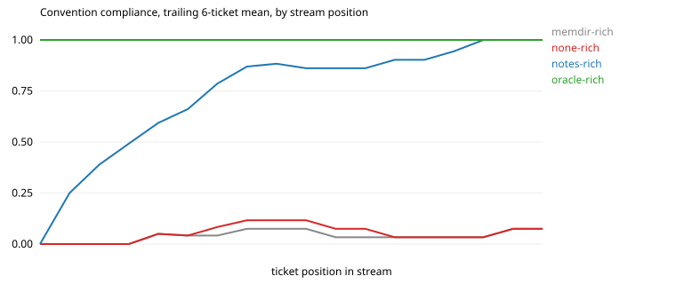

# Results: run `hd-gemma`

| arm | tickets | CI pass | compliance | hidden-rule compliance | first-try merge | early / mid / late compliance | gain vs stateless (95% CI) | oracle gap closed | repeat-violation rate | $ per ticket |
|---|---|---|---|---|---|---|---|---|---|---|
| memdir-rich | 18 | 0.89 | 0.05 | 0.00 | 0.00 | 0.04 / 0.03 / 0.07 | -0.01 (-0.04, +0.00) | -1% | 0.94 (n=65) | 0.000 |
| none-rich | 18 | 0.78 | 0.06 | 0.02 | 0.00 | 0.04 / 0.07 / 0.07 | n/a | n/a | 0.92 (n=65) | 0.000 |
| notes-rich | 18 | 0.94 | 0.84 | 0.87 | 0.56 | 0.66 / 0.86 / 1.00 | +0.78 (+0.65, +0.88) | 83% | 0.03 (n=65) | 0.000 |
| oracle-rich | 18 | 1.00 | 1.00 | 1.00 | 1.00 | 1.00 / 1.00 / 1.00 | +0.94 (+0.88, +0.98) | 100% | n/a (n=0) | 0.000 |

Hidden rules, which a stateless frontier model follows less than half the time: `escalate`, `escalate_finance`, `no_dates`, `signoff`, `tag`.

## Compliance by how many times the agent has met the convention

| arm | 1st exposure | 2nd to 3rd | 4th and later |
|---|---|---|---|
| memdir-rich | 0.00 | 0.06 | 0.06 |
| none-rich | 0.00 | 0.12 | 0.06 |
| notes-rich | 0.00 | 1.00 | 0.96 |
| oracle-rich | 1.00 | 1.00 | 1.00 |

## Rules introduced by a mid-stream change

| arm | `escalate_finance` in order (1 = followed) |
|---|---|
| memdir-rich | 00000 |
| none-rich | 00000 |
| notes-rich | 01111 |
| oracle-rich | 11111 |

