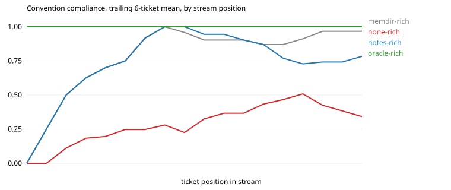

# Results: run `hd-haiku-s1`

| arm | tickets | CI pass | compliance | hidden-rule compliance | first-try merge | early / mid / late compliance | gain vs stateless (95% CI) | oracle gap closed | repeat-violation rate | $ per ticket |
|---|---|---|---|---|---|---|---|---|---|---|
| memdir-rich | 18 | 0.94 | 0.89 | 0.91 | 0.72 | 0.72 / 0.94 / 1.00 | +0.58 (+0.43, +0.72) | 84% | 0.00 (n=60) | 0.013 |
| none-rich | 18 | 0.72 | 0.31 | 0.19 | 0.00 | 0.29 / 0.19 / 0.46 | n/a | n/a | 0.69 (n=61) | 0.006 |
| notes-rich | 18 | 0.61 | 0.79 | 0.79 | 0.22 | 0.75 / 0.90 / 0.72 | +0.48 (+0.31, +0.64) | 69% | 0.12 (n=57) | 0.009 |
| oracle-rich | 18 | 0.72 | 1.00 | 1.00 | 0.72 | 1.00 / 1.00 / 1.00 | +0.69 (+0.58, +0.79) | 100% | nan (n=0) | 0.005 |

Hidden rules are the ones the stateless arm follows less than half the time: `escalate`, `greeting`, `no_dates`, `signoff`, `tag`.

## Compliance by how many times the agent has met the convention

| arm | 1st exposure | 2nd to 3rd | 4th and later |
|---|---|---|---|
| memdir-rich | 0.12 | 1.00 | 1.00 |
| none-rich | 0.38 | 0.38 | 0.29 |
| notes-rich | 0.25 | 1.00 | 0.84 |
| oracle-rich | 1.00 | 1.00 | 1.00 |

## After the migration (`events` replaces `audit`)

| arm | `events` outcomes in order (1 = followed) |
|---|---|
| memdir-rich | n/a |
| none-rich | n/a |
| notes-rich | n/a |
| oracle-rich | n/a |

