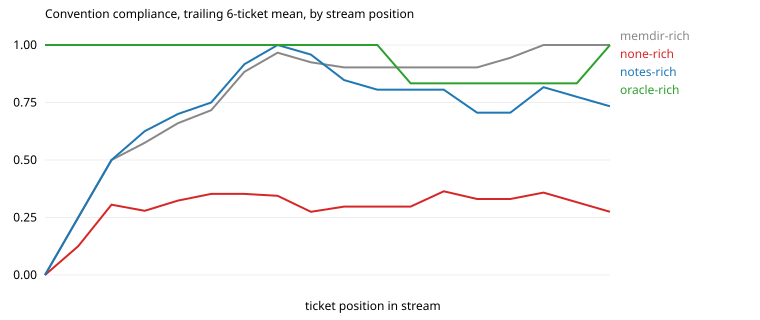

# Results: run `hd-haiku-s2`

| arm | tickets | CI pass | compliance | hidden-rule compliance | first-try merge | early / mid / late compliance | gain vs stateless (95% CI) | oracle gap closed | repeat-violation rate | $ per ticket |
|---|---|---|---|---|---|---|---|---|---|---|
| memdir-rich | 18 | 0.89 | 0.87 | 0.90 | 0.67 | 0.72 / 0.90 / 1.00 | +0.56 (+0.45, +0.68) | 89% | 0.00 (n=63) | 0.014 |
| none-rich | 18 | 0.78 | 0.31 | 0.19 | 0.00 | 0.35 / 0.30 / 0.27 | n/a | n/a | 0.76 (n=58) | 0.006 |
| notes-rich | 18 | 0.67 | 0.76 | 0.77 | 0.28 | 0.75 / 0.81 / 0.73 | +0.45 (+0.34, +0.57) | 71% | 0.15 (n=59) | 0.008 |
| oracle-rich | 18 | 0.89 | 0.94 | 0.96 | 0.89 | 1.00 / 0.83 / 1.00 | +0.64 (+0.47, +0.77) | 100% | 0.00 (n=17) | 0.005 |

Hidden rules, which a stateless frontier model follows less than half the time: `escalate`, `escalate_finance`, `no_dates`, `signoff`, `tag`.

## Compliance by how many times the agent has met the convention

| arm | 1st exposure | 2nd to 3rd | 4th and later |
|---|---|---|---|
| memdir-rich | 0.12 | 0.94 | 1.00 |
| none-rich | 0.38 | 0.44 | 0.24 |
| notes-rich | 0.25 | 0.94 | 0.82 |
| oracle-rich | 1.00 | 1.00 | 0.92 |

## Rules introduced by a mid-stream change

| arm | `escalate_finance` in order (1 = followed) |
|---|---|
| memdir-rich | 01111 |
| none-rich | 10000 |
| notes-rich | 01111 |
| oracle-rich | 11111 |

