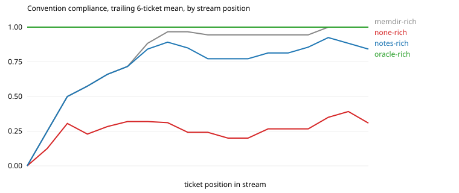

# Results: run `hd-opus-s2`

| arm | tickets | CI pass | compliance | hidden-rule compliance | first-try merge | early / mid / late compliance | gain vs stateless (95% CI) | oracle gap closed | repeat-violation rate | $ per ticket |
|---|---|---|---|---|---|---|---|---|---|---|
| memdir-rich | 18 | 1.00 | 0.89 | 0.90 | 0.78 | 0.72 / 0.94 / 1.00 | +0.61 (+0.50, +0.72) | 84% | 0.00 (n=60) | 0.359 |
| none-rich | 18 | 0.89 | 0.28 | 0.13 | 0.00 | 0.32 / 0.20 / 0.31 | n/a | n/a | 0.77 (n=60) | 0.151 |
| notes-rich | 18 | 1.00 | 0.78 | 0.75 | 0.39 | 0.72 / 0.77 / 0.84 | +0.50 (+0.40, +0.60) | 69% | 0.13 (n=60) | 0.172 |
| oracle-rich | 18 | 1.00 | 1.00 | 1.00 | 1.00 | 1.00 / 1.00 / 1.00 | +0.72 (+0.63, +0.82) | 100% | n/a (n=0) | 0.092 |

Hidden rules, which a stateless frontier model follows less than half the time: `escalate`, `escalate_finance`, `no_dates`, `signoff`, `tag`.

## Compliance by how many times the agent has met the convention

| arm | 1st exposure | 2nd to 3rd | 4th and later |
|---|---|---|---|
| memdir-rich | 0.12 | 1.00 | 1.00 |
| none-rich | 0.12 | 0.38 | 0.27 |
| notes-rich | 0.12 | 0.94 | 0.86 |
| oracle-rich | 1.00 | 1.00 | 1.00 |

## Rules introduced by a mid-stream change

| arm | `escalate_finance` in order (1 = followed) |
|---|---|
| memdir-rich | 01111 |
| none-rich | 00000 |
| notes-rich | 01111 |
| oracle-rich | 11111 |

