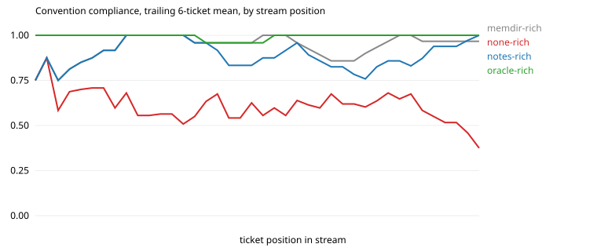

# Results: run `opus-v2-s2`

| arm | tickets | CI pass | compliance | hidden-rule compliance | first-try merge | early / mid / late compliance | gain vs stateless (95% CI) | oracle gap closed | repeat-violation rate | $ per ticket |
|---|---|---|---|---|---|---|---|---|---|---|
| memdir-rich | 40 | 1.00 | 0.95 | 0.86 | 0.80 | 0.94 / 0.92 / 0.98 | +0.36 (+0.28, +0.45) | 89% | 0.03 (n=67) | 0.556 |
| none-rich | 40 | 1.00 | 0.59 | 0.09 | 0.10 | 0.64 / 0.58 / 0.54 | n/a | n/a | 0.44 (n=135) | 0.149 |
| notes-rich | 40 | 1.00 | 0.90 | 0.78 | 0.68 | 0.94 / 0.85 / 0.92 | +0.32 (+0.23, +0.41) | 78% | 0.08 (n=88) | 0.300 |
| oracle-rich | 40 | 0.97 | 0.99 | 1.00 | 0.97 | 1.00 / 0.98 / 1.00 | +0.41 (+0.32, +0.50) | 100% | 0.00 (n=20) | 0.167 |

Hidden rules, which a stateless frontier model follows less than half the time: `idempotent`, `money`, `no_legacy`, `settings`, `sorted`, `tests`.

## Compliance by how many times the agent has met the convention

| arm | 1st exposure | 2nd to 3rd | 4th and later |
|---|---|---|---|
| memdir-rich | 0.50 | 1.00 | 0.99 |
| none-rich | 0.57 | 0.50 | 0.61 |
| notes-rich | 0.43 | 0.89 | 0.96 |
| oracle-rich | 1.00 | 1.00 | 0.99 |

## Rules introduced by a mid-stream change

| arm | `events` in order (1 = followed) | `changelog2` in order (1 = followed) | `sorted` in order (1 = followed) | `idempotent` in order (1 = followed) | `settings` in order (1 = followed) | `docs_api` in order (1 = followed) |
|---|---|---|---|---|---|---|
| memdir-rich | 0111111111111111 | 11111111 | 011111 | 011111 | 011011 | 111111111111 |
| none-rich | 1011011011111010 | 11000111 | 000000 | 000010 | 000000 | 101111110100 |
| notes-rich | 0111111111111111 | 10111111 | 001111 | 011111 | 001111 | 011111111111 |
| oracle-rich | 1111111111111111 | 11111111 | 111111 | 111111 | 111111 | 111111111111 |

